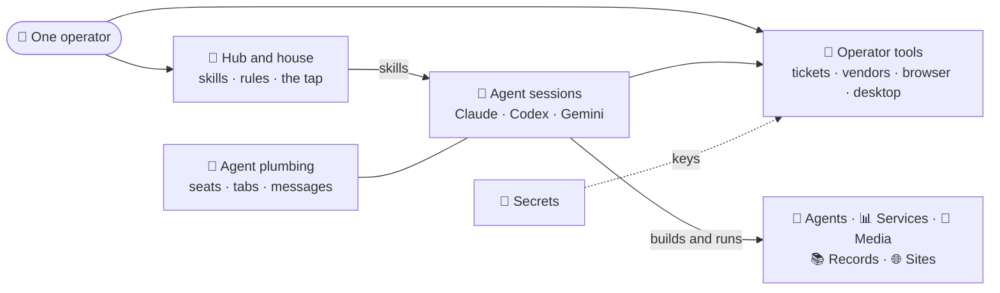

# 🧭 Ecosystem

**The working fleet: agents, tools, services, media and UI.** 
Many carry Norse names. Almost everything cross-cuts via **[bifrost](https://github.com/21StarkCom/bifrost)**.

**48 repos** · [← the fleet](https://github.com/21StarkCom/.github/blob/main/profile/README.md#the-fleet) · [the saga](saga.md) · [not in the fleet](exclusions.md)

⭐ public · 🔒 internal · everything else private · 🤝 shared building block · ✏️ WIP

## How it fits together

| | Group | What lives here |
| :-: | :-- | :-- |
| 🌈 | **[Hub and house](#-hub-and-house)** | The skills hub, the house rules, the front door, the tap and the graveyard. Everything else leans on these. |
| 🤖 | **[Agents](#-agents)** | Workers with a job of their own: counsel, review, hygiene, memory and admin chores. |
| 📡 | **[Agent plumbing](#-agent-plumbing)** | Seats, tabs, messages and progress reports: what keeps many agents working side by side. |
| 🧰 | **[Operator tools](#-operator-tools)** | The CLIs that the operator and the agents reach for every day: tickets, vendors, the browser and the desktop. |
| 🔐 | **[Secrets and devices](#-secrets-and-devices)** | The vault, its Linux mirror, and the phones, watches and radios around the Mac. |
| 📊 | **[Services and apps](#-services-and-apps)** | Long-running services on Cloud Run and GKE, and the apps in front of them. |
| 🎨 | **[Design, media and docs](#-design-media-and-docs)** | Make things: UI kits, images and video, voice, and Office files. |
| 📚 | **[Records and registries](#-records-and-registries)** | Text-first records of accounts, plans, decisions and docs. |
| 🌐 | **[Sites and errands](#-sites-and-errands)** | The public faces of the fleet, and one personal chore done by robots. |

## 🌈 Hub and house

*The skills hub, the house rules, the front door, the tap and the graveyard. Everything else leans on these.*

| Repo | Lang | What it is |
| :-- | :-- | :-- |
| **[bifrost](https://github.com/21StarkCom/bifrost)** ⭐ 🤝 | `TypeScript` | The stark workflow hub — runtime-neutral agent skills and the tools they call, served straight from source as a seven-plugin Claude Code marketplace; Codex runs them too. |
| **[idavoll](https://github.com/21StarkCom/idavoll)** 🤝 | `Go` | The workspace constitution and bootstrap — the fleet's root operator rules and repo map, plus installers that rebuild a Mac, a Linux devbox or a Windows box from zero. |
| **[.github](https://github.com/21StarkCom/.github)** ⭐ | `Shell` | The org's public front door — the org profile, the fleet pages and their saga, and the reusable gitleaks secret scan that the fleet pins by commit. |
| **[homebrew-tap](https://github.com/21StarkCom/homebrew-tap)** | `Ruby` | The fleet's private Homebrew tap — formulae for its CLIs and casks for its Mac apps, each pinned to a release that its source repo re-pins. |
| **[nastrond](https://github.com/21StarkCom/nastrond)** | `TypeScript` | The fleet's code graveyard — dead subsystems buried as source and retired repos sealed as encrypted bundles, each under a tombstone; kept to be remembered, never run. |

## 🤖 Agents

*Workers with a job of their own: counsel, review, hygiene, memory and admin chores.*

| Repo | Lang | What it is |
| :-- | :-- | :-- |
| **[odin](https://github.com/21StarkCom/odin)** ✏️ | `TypeScript` | The fleet's agent kernel — a Claude Agent SDK call loop with a default-deny tool guard that turns a playbook file into a named agent; first slice built, not yet published. |
| **[lucius](https://github.com/21StarkCom/lucius)** | `TypeScript` | The interactive brainstorming partner — a terminal and local-web app on the Claude Agent SDK (OpenAI and Gemini selectable) that recalls, argues and digs, and ships nothing; released through the tap. |
| **[forseti](https://github.com/21StarkCom/forseti)** ✏️ | `TypeScript` | The legal counsel agent — reads terms, policies and contracts into its own vault and answers questions with every claim cited; v1 runs from source, with no release yet. |
| **[syn](https://github.com/21StarkCom/syn)** | `TypeScript` | The PR review bot — a Claude agent with read-only tools reviews new PRs in chosen repos, posts one review and sends a Slack notice; live as a background service. |
| **[hygiea](https://github.com/21StarkCom/hygiea)** | `Go` | The repo-hygiene agent — a Claude Code subagent that proves dead code, stale docs and unused deps before it removes any of them, and never merges. |
| **[muninn](https://github.com/21StarkCom/muninn)** ✏️ | `Go` | The planned fleet harvester — will read the fleet through frigg and slackctl and accrete what it learns into durable entity notes; only its offline core is built. |
| **[user-management-agent](https://github.com/21StarkCom/user-management-agent)** | `Go` | uma — records SaaS admin onboarding and offboarding flows in Chrome, distills them with Claude into reviewed playbooks and replays them per user; a Go CLI plus a macOS app. |

## 📡 Agent plumbing

*Seats, tabs, messages and progress reports: what keeps many agents working side by side.*

| Repo | Lang | What it is |
| :-- | :-- | :-- |
| **[hermod](https://github.com/21StarkCom/hermod)** | `TypeScript` | The cmux client and fleet-coordination toolkit — coequal TypeScript and Go clients over cmux's control API that launch agents on tickets, message peers and tear sessions down. |
| **[agent-seats](https://github.com/21StarkCom/agent-seats)** | `TypeScript` | Seat tooling for one operator — the agent-seats CLI keeps several Claude Code and Codex logins, shows live usage and rotates them, plus a one-click sign-in Chrome extension. |
| **[ratatoskr](https://github.com/21StarkCom/ratatoskr)** ✏️ | `TypeScript` | The agent-to-agent message bridge — a research-spike Claude Code channel that carries Codex messages to Claude and relays permission prompts; proven live once, unreleased. |
| **[houston](https://github.com/21StarkCom/houston)** | `TypeScript` | Epic progress overwatch — a local, push-only server where agents report gate transitions, with one page of parallel tracks per epic; built, but no agent reports to it yet. |
| **[stark-stream-deck-sdk](https://github.com/21StarkCom/stark-stream-deck-sdk)** | `TypeScript` | The workspace for Elgato Stream Deck plugins — home of agent-deck, which puts each Claude Code session on a key and answers an agent's question with a press. |

## 🧰 Operator tools

*The CLIs that the operator and the agents reach for every day: tickets, vendors, the browser and the desktop.*

| Repo | Lang | What it is |
| :-- | :-- | :-- |
| **[alfred](https://github.com/21StarkCom/alfred)** | `Go` | The always-on ops butler — a CLI and a daemon that own the operator's tickets, todos and reminders, run a Slack agent and give every agent session an MCP surface. |
| **[idun](https://github.com/21StarkCom/idun)** | `TypeScript` | Aryeh's personal-ops CLI — one compiled Bun binary that launches Claude and Codex agents, carries PRs through merge and cleanup, and keeps the machine clean. |
| **[frigg](https://github.com/21StarkCom/frigg)** | `Go` | The IT-ops CLI and TUI cockpit — Google Workspace and the fleet's vendor connectors behind gated, dry-run-first writes, plus the local identity cache; released through the tap. |
| **[tyr](https://github.com/21StarkCom/tyr)** 🤝 | `Go` | The vendor-integration capability library — typed, gated Go capabilities over the fleet's third-party systems, split into per-vendor modules; library-only, with frigg as its CLI. |
| **[fenrir](https://github.com/21StarkCom/fenrir)** | `TypeScript` | The TypeScript twin of tyr — a multi-vendor SDK and CLI built for agents (ClickUp, GitHub, Google Workspace and more), with compact output, typed errors and gated writes. |
| **[sleipnir](https://github.com/21StarkCom/sleipnir)** | `TypeScript` | Two sibling browser products — Sleipnir runs caps and an MCP server on persistent, allowlisted Chrome profiles, and Huginn's extensions act in the operator's own Chrome; released through the tap. |
| **[goldfinger](https://github.com/21StarkCom/goldfinger)** | `Swift` | Background computer use for AI agents — a signed helper-app daemon, driven by a CLI and an MCP server, that operates native apps without taking focus; released for macOS, Linux not started. |

## 🔐 Secrets and devices

*The vault, its Linux mirror, and the phones, watches and radios around the Mac.*

| Repo | Lang | What it is |
| :-- | :-- | :-- |
| **[mimir](https://github.com/21StarkCom/mimir)** | `Swift` | The personal macOS credential vault — one encrypted, Touch ID-locked vault that the app, the mimir CLI and an opt-in MCP server read, with Drive backup; a cask on the tap. |
| **[mimir-linux](https://github.com/21StarkCom/mimir-linux)** | `Go` | The headless Linux mirror of the Mímir vault — a Go daemon and client that serve it read-only from signed bundles the Mac publishes; shipped as signed releases. |
| **[heimdall](https://github.com/21StarkCom/heimdall)** | `Go` | The personal cross-device notification relay — one heimdall send raises a Mac banner and pushes to iPhone and Watch through your own APNs key, via a Go server on GKE. |
| **[vor](https://github.com/21StarkCom/vor)** | `Swift` | The Mac radio sensor — a zero-dependency Swift CLI that ranks nearby Bluetooth devices by signal and reads WiFi, with an iOS app on the same core; unsigned, run from source. |
| **[gjallarhorn](https://github.com/21StarkCom/gjallarhorn)** ✏️ | `Swift` | The side-loaded iPhone app that copies Plaud voice-recorder recordings over Bluetooth into Google Drive; pre-1.0, and its upload has not yet run end to end on a device. |

## 📊 Services and apps

*Long-running services on Cloud Run and GKE, and the apps in front of them.*

| Repo | Lang | What it is |
| :-- | :-- | :-- |
| **[kotodama](https://github.com/21StarkCom/kotodama)** | `Go` | The multi-user meeting-recording and transcription service — audio in from uploads, Drive, Zoom, Meet and a recorder bot; named speakers, summaries and action items out; Go and Next.js on GKE. |
| **[stark-slack-indexer](https://github.com/21StarkCom/stark-slack-indexer)** | `Go` | The Slack corpus search backend — Cloud Run jobs index exports into BigQuery for hybrid search, and a local MCP server and the slackctl CLI query it, with an agentic ask. |
| **[stark-showcase](https://github.com/21StarkCom/stark-showcase)** | `Go` | The HTML page hosting and gallery service — upload, validate, index and serve pages behind sign-in, with revocable share links and an MCP server that publishes from Claude. |
| **[assay](https://github.com/21StarkCom/assay)** ✏️ | `Go` | The daily verified-trend newsletter for AI — a GKE pipeline scores each candidate against a rubric and keeps only what clears the bar; its reader site is not built yet. |
| **[meridian](https://github.com/21StarkCom/meridian)** | `Go` | The GCP FinOps service and its GKE platform — a Go service that tracks GCP cost, BigQuery usage and resource inventory; the original engineering-ops console is decommissioned. |
| **[yggdrasil](https://github.com/21StarkCom/yggdrasil)** ✏️ | `TypeScript` | The world-tree for goals — a planned Forge app for Evinced Jira that shows each goal as a tree of all its work with one honest progress %; only its spec and a throwaway spike are built. |

## 🎨 Design, media and docs

*Make things: UI kits, images and video, voice, and Office files.*

| Repo | Lang | What it is |
| :-- | :-- | :-- |
| **[draupnir](https://github.com/21StarkCom/draupnir)** | `TypeScript` | The fleet's shared design system — tokens, themes, house UI, the statement-fx effects engine and icon, logo and font corpora, published as restricted npm packages. |
| **[stark-tui](https://github.com/21StarkCom/stark-tui)** 🔒 🤝 | `Go` | The fleet's terminal-UI code — a zero-dependency toolkit written twice (Go and TypeScript) for colors, spinners and prompts, plus a Charm-based library for interactive TUIs. |
| **[lumiere](https://github.com/21StarkCom/lumiere)** | `Go` | The Go toolkit for visual media — image generation and editing and short video, as CLIs behind one lumiere dispatcher plus a library; released through the tap. |
| **[plume](https://github.com/21StarkCom/plume)** | `Go` | The pure-Go Office/PDF toolkit — a dependency-free library and CLIs that read and write Excel, Word, PowerPoint and PDF, and fill and sign PDFs; released through the tap. |
| **[bragi](https://github.com/21StarkCom/bragi)** | `Go` | The Go toolkit for streaming voice — speech-to-text and text-to-speech as streams, a library plus thin CLIs so agents can listen and speak; macOS only, released through the tap. |

## 📚 Records and registries

*Text-first records of accounts, plans, decisions and docs.*

| Repo | Lang | What it is |
| :-- | :-- | :-- |
| **[apple-developer](https://github.com/21StarkCom/apple-developer)** | `Go` | The versioned text registry of the Apple Developer / App Store Connect account — an appledev CLI reconciles it with Apple and logs each notarization the fleet's releases make. |
| **[atlassian-management](https://github.com/21StarkCom/atlassian-management)** | `Python` | The operator's Jira admin record — a read-only Python audit of what the operator's account and its agents changed on a Jira site, plus a decision register and how-tos. |
| **[workplan-tools](https://github.com/21StarkCom/workplan-tools)** | `Go` | The plan-intent layer for the Infra group — a pre-1.0 Go CLI that snapshots a work-plan sheet into immutable, typed, diffable plans, with a weekly capture on Cloud Run. |
| **[vault-docs](https://github.com/21StarkCom/vault-docs)** | `—` | The vendor-docs vaults — vendor documentation sites harvested into clean Markdown that atlas indexes for agents, starting with the Jira Cloud docs. |
| **[manual-auditor-project](https://github.com/21StarkCom/manual-auditor-project)** | `Python` | The Manual Auditor project's research knowledge base — read-only harvests of its sources, distilled into cited pages, findings and entities in an Obsidian vault. |

## 🌐 Sites and errands

*The public faces of the fleet, and one personal chore done by robots.*

| Repo | Lang | What it is |
| :-- | :-- | :-- |
| **[21stark-site](https://github.com/21StarkCom/21stark-site)** ⭐ | `MDX` | The fleet's public website — an Astro Starlight site on GitHub Pages for product policies and guides, starting with the privacy policies of the Huginn extensions. |
| **[stark-personal](https://github.com/21StarkCom/stark-personal)** | `TypeScript` | Aryeh's personal site and blog — the code behind 21stark.com: a dynamic Next.js app on Cloud Run, content in Firestore, edited live in an admin backoffice. |
| **[stark-invoices-collector](https://github.com/21StarkCom/stark-invoices-collector)** | `JavaScript` | Playwright receipt connectors — find card charges with no receipt, fetch each one from the vendor's billing page and mail it to the card that paid; no server, no stored credential. |

---

Read the fleet as one story in <b><a href="saga.md">The Saga of House Stark</a></b>.

